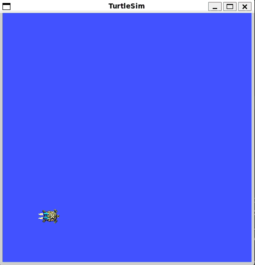
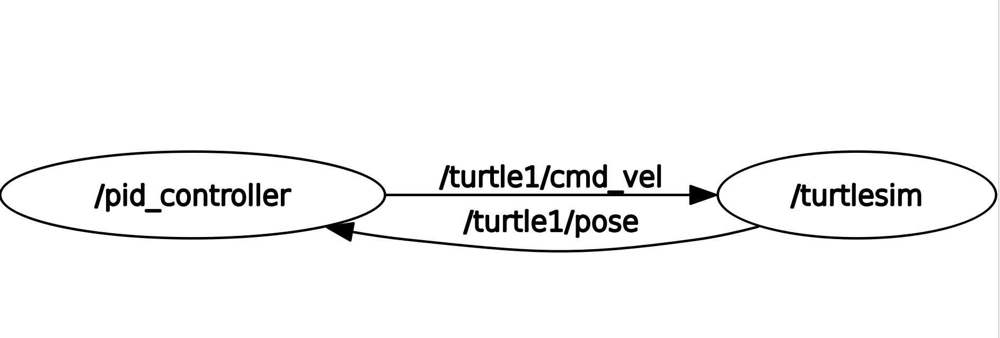

# ROS 2 PID Waypoint Controller

A ROS 2 (Jazzy) node that drives the turtlesim robot autonomously to goals and along waypoint routes, using two PID loops and a simple safety layer.

<p align="center">
  
</p>

## Features

- **PID go-to-goal control**: one PID loop for forward speed (distance error) and one for turning (heading error)
- **Waypoint following**: visits a list of points in order, with an optional patrol loop
- **Safety layer**: rejects goals outside the safe area and blocks forward motion toward walls
- **Turn-in-place threshold**: tunable trade-off between smooth curves and sharp turns
- **Runtime-tunable parameters**: gains, goals and waypoints can be changed while the node runs
- **Launch file** with launch arguments to start everything with one command

## How it works

<p align="center">
  
</p>

The controller is a closed feedback loop:

1. `/turtlesim` publishes the robot's position on `/turtle1/pose`.
2. `/pid_controller` subscribes to it and computes, at 20 Hz:
   - **distance error** = distance to the current goal → forward speed
   - **heading error** = angle to the goal − robot heading (wrapped to [−π, π]) → turning speed
3. It publishes velocity commands (`geometry_msgs/Twist`) on `/turtle1/cmd_vel`.

Speeds are clamped to safe limits. The robot turns in place until it roughly faces the goal, then drives. A final safety check blocks forward motion if the robot is near a wall and facing it.

## Requirements

- Ubuntu 24.04 (tested on WSL2)
- ROS 2 Jazzy
- `turtlesim` (included in `ros-jazzy-desktop`)

## Build

```bash
mkdir -p ~/ros2_ws/src
cd ~/ros2_ws/src
git clone https://github.com/<your-username>/turtle_pid.git
cd ~/ros2_ws
colcon build --symlink-install
source install/setup.bash
```

## Run

Start turtlesim and the controller (default goal: 8, 8):

```bash
ros2 launch turtle_pid turtle_pid.launch.py
```

Choose a different goal at startup:

```bash
ros2 launch turtle_pid turtle_pid.launch.py goal_x:=3.0 goal_y:=9.0
```

Change the goal while running:

```bash
ros2 param set /pid_controller goal_x 2.0
ros2 param set /pid_controller goal_y 3.0
```

Follow waypoints (default: a square) and patrol:

```bash
ros2 param set /pid_controller loop_waypoints true
ros2 param set /pid_controller use_waypoints true
```

Set your own route as a flat list `[x1, y1, x2, y2, ...]`:

```bash
ros2 param set /pid_controller waypoints "[3.0, 3.0, 8.0, 3.0, 5.5, 8.0]"
```

## Parameters

| Parameter | Default | Description |
|---|---|---|
| `goal_x`, `goal_y` | 8.0, 8.0 | Single goal position |
| `kp_linear`, `ki_linear`, `kd_linear` | 1.0, 0.0, 0.1 | PID gains for forward speed |
| `kp_angular`, `ki_angular`, `kd_angular` | 4.0, 0.0, 0.2 | PID gains for turning (launch file sets `kp_angular` to 6.0) |
| `max_linear`, `max_angular` | 2.0, 3.0 | Speed limits |
| `tolerance` | 0.1 | Distance at which a goal counts as reached |
| `turn_threshold` | 0.3 | Heading error (rad) above which the robot turns in place |
| `world_min`, `world_max` | 0.0, 11.08 | Size of the world |
| `safety_margin` | 0.5 | Minimum distance to keep from walls |
| `use_waypoints` | false | Follow the waypoint list instead of the single goal |
| `waypoints` | square | Flat list of points `[x1, y1, x2, y2, ...]` |
| `loop_waypoints` | false | Restart from the first waypoint after the last |

## Design notes and limitations

- **Turtlesim has no inertia or friction**, so a P controller alone already works well. The I and D terms matter more on real or physically simulated robots.
- **The robot slows down at every waypoint** because forward speed is proportional to distance. Fine for precise stops, but a path-following controller (e.g. pure pursuit) would be smoother for routes.
- **The safety layer only filters this node's commands.** Commands published directly to `/turtle1/cmd_vel` bypass it. A real robot would use a separate safety node between controllers and motors.

## Next steps

- Port the controller to a TurtleBot3 in Gazebo using `/odom` and LiDAR (`/scan`)
- Train a reinforcement learning navigation policy and benchmark it against this PID baseline
- Expose goals as a ROS 2 action with feedback and cancellation

## License

Apache-2.0